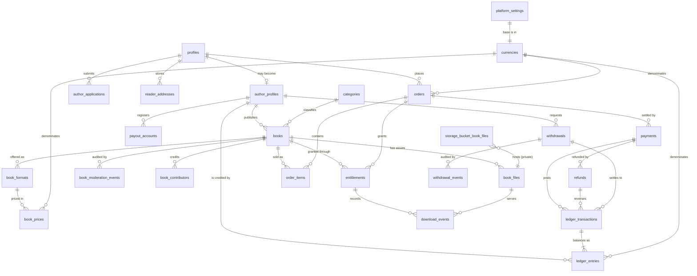
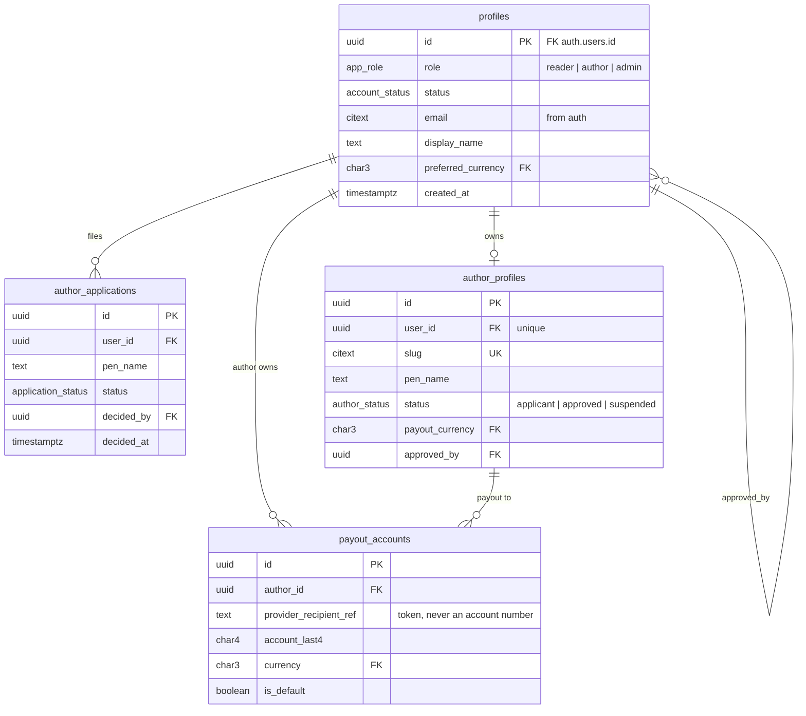
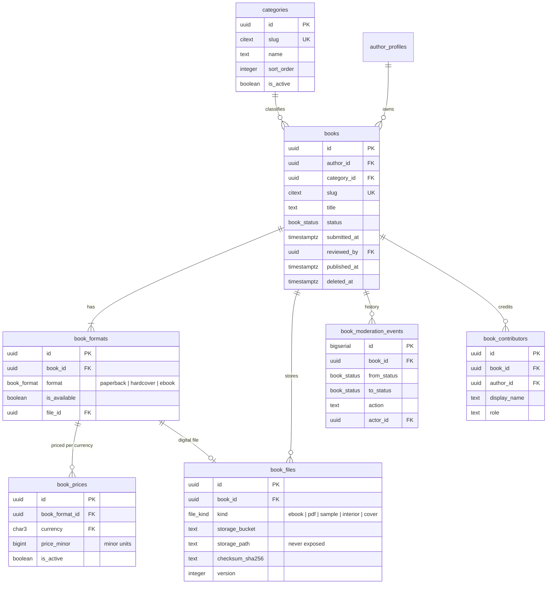
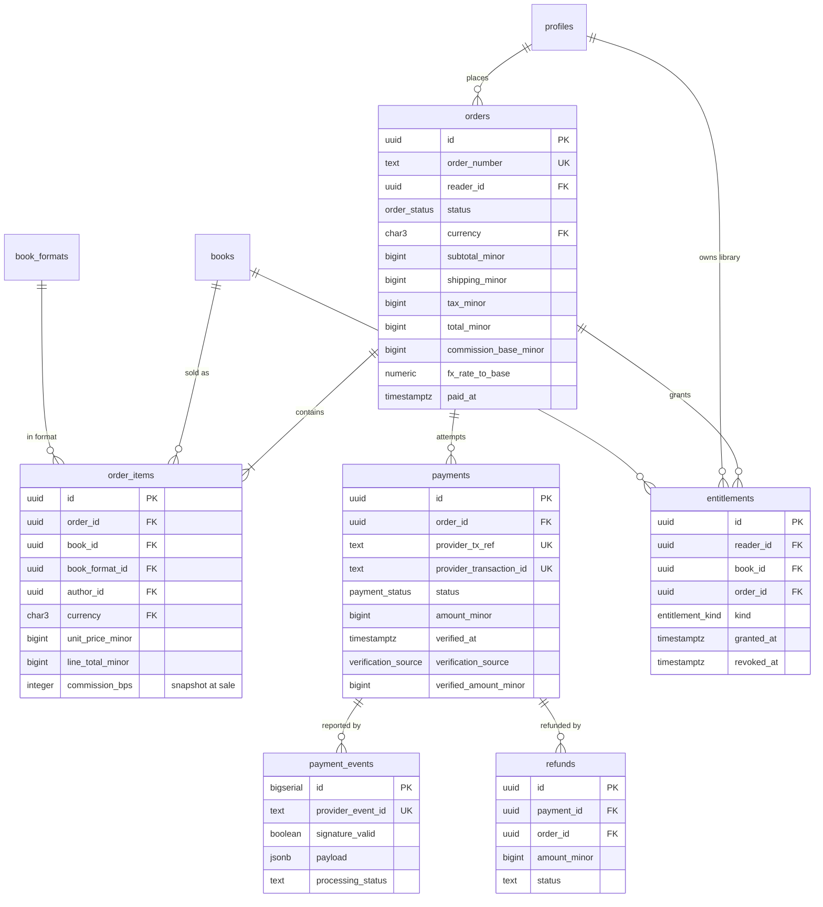
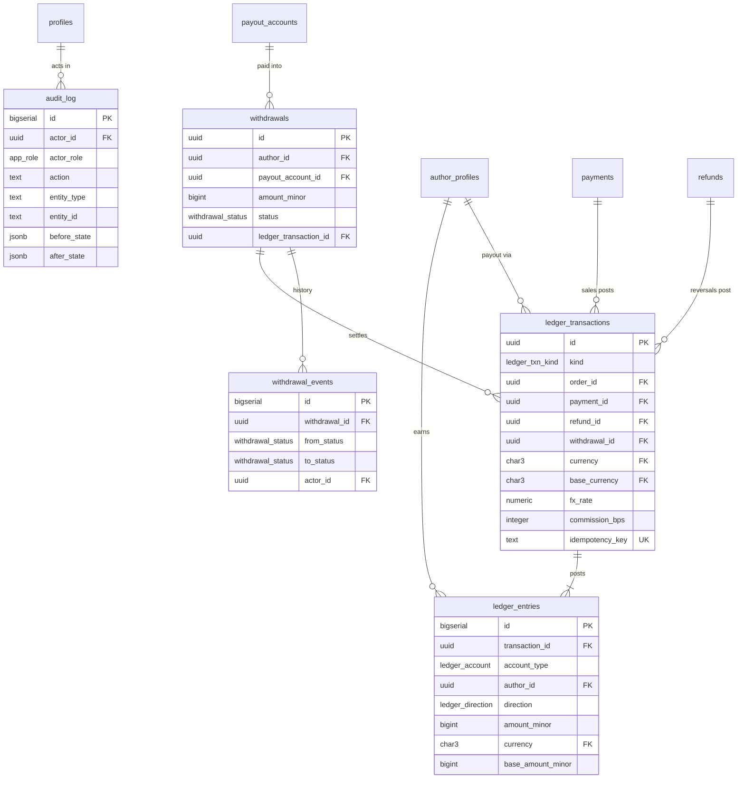
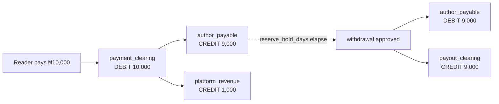
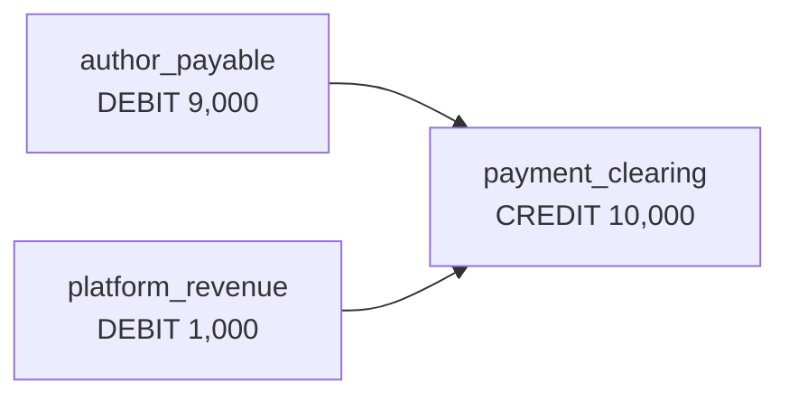
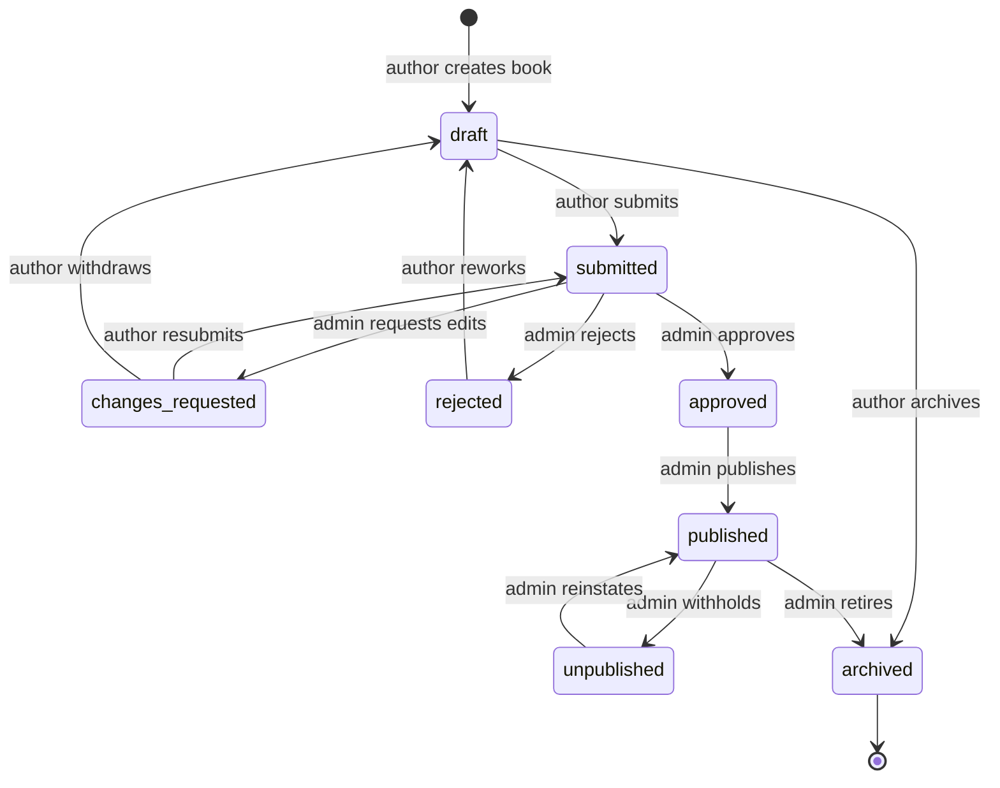
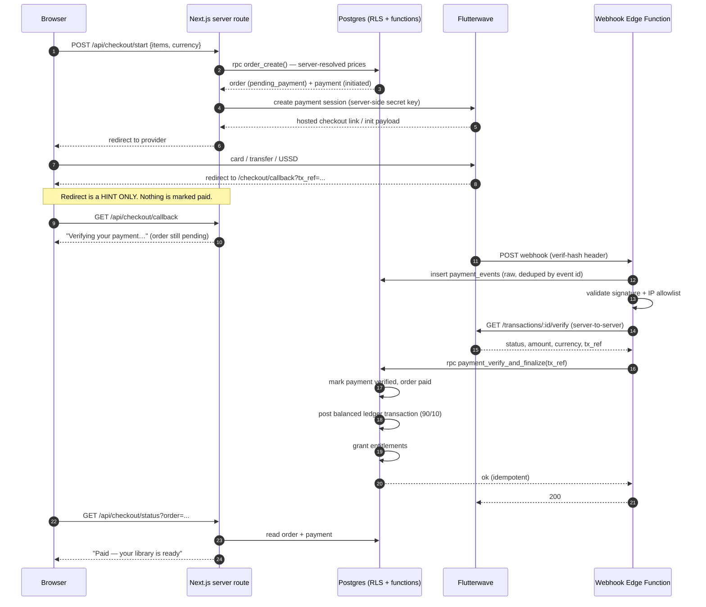

# 02 — Entity relationship diagrams

Diagrams are Mermaid, so they render directly on GitHub in the pull request. A
plain-text relationship table follows each diagram for reviewers who prefer it
(and for anywhere Mermaid is not rendered).

The schema is split into five domains so each diagram stays readable:

1. Identity & author onboarding
2. Catalogue & moderation
3. Commerce & payments
4. Money, ledger & payouts
5. Fulfilment & storage

---

## 1. Domain overview

> `storage_bucket_book_files` is illustrative only — Supabase Storage is managed
> outside the `public` schema. Bucket layout is specified in doc 04.

---

## 2. Identity & author onboarding

**Rules embodied here**

- One `profiles` row per `auth.users` row (created by trigger).
- `author_profiles.user_id` is `UNIQUE`: a user is at most one author identity.
- `author_profiles.status = 'approved'` is only reachable by an admin decision
  recorded in `author_applications` and `audit_log`.
- `payout_accounts` stores a provider token and `last4` — no account numbers.

---

## 3. Catalogue & moderation

**Reading the cardinalities:** a book must have at least one format to be
published; a digital format needs a `book_files` row; a format may be priced in
several currencies, one row each.

---

## 4. Commerce & payments

**Invariant shown above:** `payments.status = 'succeeded'` is impossible unless
`verified_at`, `verification_source` and `verified_amount_minor` are all set —
enforced by a table-level `CHECK`.

---

## 5. Money, ledger & payouts

---

## 6. Money flow for one ₦10,000 sale

The same shape is used for every currency; amounts below are illustrative of the
90/10 rule, not of real prices.

Balanced within one `ledger_transactions` row: debits 10,000 = credits 10,000.

Refund of the same order posts a new transaction, never edits the first:

---

## 7. Book approval state machine

Author-allowed transitions are only `draft → submitted`,
`changes_requested → submitted`, `changes_requested → draft` and `→ archived`.
Everything else requires the service role (administrator actions) and is checked
in the `books_status_guard` trigger — not just in the UI.

---

## 8. Payment verification sequence

A polling page and a scheduled reconciliation job both call the **same**
server-side verification path, so a missed webhook cannot lose a sale and a
forged redirect cannot create one.

---

## 9. Relationship reference table

| Parent | Child | Cardinality | On delete |
| --- | --- | --- | --- |
| `auth.users` | `profiles` | 1 : 1 | restrict |
| `profiles` | `author_profiles` | 1 : 0..1 | restrict |
| `profiles` | `author_applications` | 1 : 0..n | cascade |
| `author_profiles` | `books` | 1 : 0..n | restrict |
| `categories` | `books` | 1 : 0..n | restrict |
| `books` | `book_formats` | 1 : 1..n | cascade |
| `book_formats` | `book_prices` | 1 : 1..n (one per currency) | cascade |
| `books` | `book_files` | 1 : 0..n | cascade |
| `books` | `book_moderation_events` | 1 : 0..n | cascade |
| `books` | `book_contributors` | 1 : 0..n | cascade |
| `profiles` | `orders` | 1 : 0..n | restrict |
| `orders` | `order_items` | 1 : 1..n | cascade |
| `orders` | `payments` | 1 : 0..n (retries allowed) | restrict |
| `payments` | `refunds` | 1 : 0..n | restrict |
| `payments` | `payment_events` | 1 : 0..n (by reference) | — |
| `orders` | `entitlements` | 1 : 0..n | set null |
| `ledger_transactions` | `ledger_entries` | 1 : 2..n (always balanced) | restrict |
| `author_profiles` | `withdrawals` | 1 : 0..n | restrict |
| `payout_accounts` | `withdrawals` | 1 : 0..n | restrict |
| `withdrawals` | `withdrawal_events` | 1 : 0..n | cascade |
| `entitlements` | `download_events` | 1 : 0..n | set null |

Every `restrict` above is intentional: financial and ownership records are never
silently deleted by a cascade.
