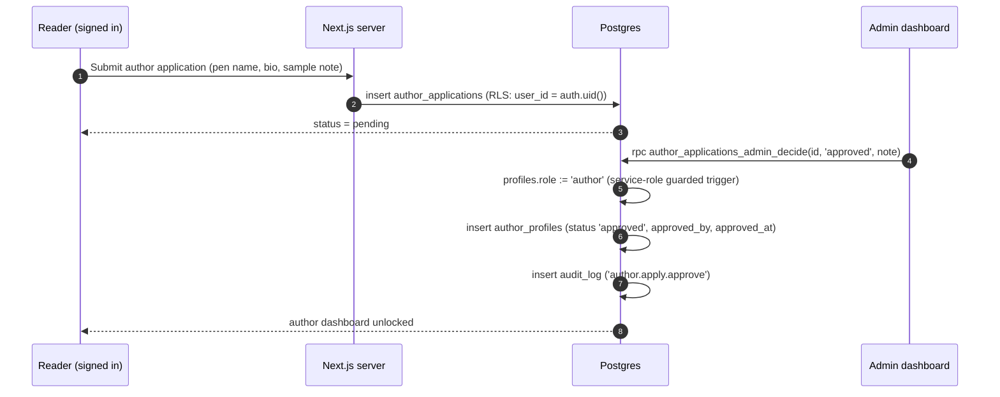

# 03 — Authentication & permission design

The single most important rule in this document:

> **A user's role is data the server controls, never data the client sends.**

Nothing in this design trusts a value from the browser — not `role`, not `author_id`,
not `reader_id`, not a price, not an amount, not an "order is paid" flag.

---

## 1. Identity

Supabase Auth is the only identity provider. There is no custom user table, no
custom password hashing and no custom session handling.

| Concern | Design |
| --- | --- |
| Sign-up | Email + password, or email magic link. Email confirmation **required** before any session is trusted |
| Sign-in | Password or magic link; OAuth (Google) can be enabled later without schema change |
| Sessions | Supabase JWTs (short-lived access token + rotating refresh token), stored in httpOnly cookies via `@supabase/ssr` |
| Password reset | Supabase-hosted recovery flow; tokens are single-use and time-limited |
| MFA | TOTP available for admin accounts (recommended at launch of the admin dashboard) |
| Account deletion | Soft delete: `profiles.status = 'deleted'`, PII scrubbed, financial rows retained (legal requirement) |
| Admin accounts | Created only by an existing admin or by CLI using the service role; **admin sign-up is not exposed** |

`profiles` is created by an `AFTER INSERT` trigger on `auth.users`
([doc 01 §4.1](./01-database-schema.md)). The trigger sets `role = 'reader'`
always; the metadata the client passed at sign-up can populate `display_name` and
`full_name` only. A client cannot inject a role through `raw_user_meta_data`.

### Session handling in Next.js

- `@supabase/ssr` with cookie-based session; server components and route handlers
  read the session from cookies, never from `localStorage`.
- A middleware refreshes the session cookie and guards `/account`, `/author` and
  `/admin` route trees.
- Authorization is **always** re-checked in the data layer too. Middleware is a
  convenience for UX redirects, never the only control — RLS is the real boundary.

---

## 2. Roles

Three roles, one per account, stored in `profiles.role`:

| Role | Who | Can do |
| --- | --- | --- |
| `reader` | Anyone who signs up | Buy books (when payments are live), own library, download owned files, own profile, own orders, save books to their wishlist |
| `author` | A reader whose application was approved | Everything a reader can, **plus** manage their own book catalogue, submit for review, see their own sales/earnings, request withdrawals |
| `admin` | Staff, provisioned by the platform owner | Moderate books, manage authors, manage orders/refunds, verify payments, process withdrawals, manage settings, read audit log |

### Capability matrix

| Capability | Anonymous | Reader | Author (own) | Author (other) | Admin |
| --- | :--: | :--: | :--: | :--: | :--: |
| Browse published catalogue | ✅ | ✅ | ✅ | ✅ | ✅ |
| Read published book detail / preview text | ✅ | ✅ | ✅ | ✅ | ✅ |
| Sign in / manage own profile | — | ✅ | ✅ | ✅ | ✅ |
| Place an order | — | ✅ | ✅ | ✅ | ✅ |
| View own orders | — | ✅ | ✅ | ✅ | ✅ |
| View another reader's orders | ❌ | ❌ | ❌ | ❌ | ✅ (audited) |
| Download a purchased file | ❌ | ✅ own | ✅ own | ❌ | ✅ (audited) |
| Create a book | ❌ | ❌ | ✅ | — | ✅ |
| Read own book `draft` | ❌ | ❌ | ✅ | — | ✅ |
| Read another author's `draft` | ❌ | ❌ | ❌ | ❌ | ✅ |
| Submit own book for review | ❌ | ❌ | ✅ | — | ✅ |
| Approve / reject / publish a book | ❌ | ❌ | ❌ | ❌ | ✅ |
| See own sales lines & earnings | ❌ | ❌ | ✅ | — | ✅ |
| See another author's earnings | ❌ | ❌ | ❌ | ❌ | ✅ (audited) |
| Read `ledger_entries` | ❌ | ❌ | own rows only | ❌ | ✅ |
| Write to the ledger | ❌ | ❌ | ❌ | ❌ | ❌ (service role only, via functions) |
| Request a withdrawal | ❌ | ❌ | ✅ | — | — |
| Approve a withdrawal | ❌ | ❌ | ❌ | ❌ | ✅ |
| Change commission settings | ❌ | ❌ | ❌ | ❌ | ✅ (audited) |
| Change any user's role | ❌ | ❌ | ❌ | ❌ | ✅ via audited function only |

---

## 3. Becoming an author



Invariants:

- A user cannot insert into `author_profiles` at all.
- A user cannot update their own `profiles.role` (guard trigger rejects unless the
  statement runs as `service_role`).
- Only one pending application per user (`author_applications_one_open` index).
- Rejection keeps the audit trail; re-application is a new row.

---

## 4. Service role & privileged server code

The service-role key bypasses RLS. It is therefore treated as a production
credential:

| Rule | Detail |
| --- | --- |
| Never in the browser | Only in server-side code: route handlers, server actions, Edge Functions. No `NEXT_PUBLIC_` prefix, ever |
| Single accessor | One module (`lib/supabase/admin.ts`) reads `SUPABASE_SERVICE_ROLE_KEY`; lint rule forbids importing it from client components |
| Narrow use | Only for: payment verification/finalisation, webhook processing, admin actions, scheduled reconciliation, storage signing |
| Always audited | Every service-role write to a user-visible entity writes `audit_log` |
| Rotatable | Key rotation procedure documented; nothing hard-codes it |
| Environment separation | Different keys per environment; preview deployments use a **non-production** Supabase project |

Client-side code only ever receives the anon key, which grants nothing beyond what
RLS allows.

---

## 5. RLS design principles

1. **Deny by default.** RLS is enabled on every table; no policy means no access.
2. **Two hard rules first.** `is_admin()` and `current_author_id()` are
   `SECURITY DEFINER` helpers that read the caller's own `profiles` row by
   `auth.uid()` — the client cannot influence their result.
3. **Ownership is compared to the row, never to the payload.** Policies test
   `author_id = current_author_id()`, not `NEW.author_id = current_author_id()`.
4. **Published data is public, everything else is not.** Public read is granted
   only through the `published_books` / `published_book_offers` views and a narrow
   policy on `books`.
5. **Money tables are read-only for everyone except the service role.** No client,
   author or admin UI writes to `ledger_entries`; only ledger functions do.
6. **Scope every policy to the operation.** Separate `select` / `insert` /
   `update` / `delete` policies rather than one `for all`.
7. **No policy references mutable user metadata**, and no policy trusts a JWT claim
   other than via `auth.uid()`.

Helper functions:

```sql
create function public.is_admin()
returns boolean
language sql
stable
security definer
set search_path = public, pg_temp
as $$
  select exists (
    select 1 from public.profiles p
    where p.id = auth.uid()
      and p.role = 'admin'
      and p.status = 'active'
  );
$$;

create function public.current_author_id()
returns uuid
language sql
stable
security definer
set search_path = public, pg_temp
as $$
  select a.id
  from public.author_profiles a
  join public.profiles p on p.id = a.user_id
  where a.user_id = auth.uid()
    and p.status = 'active'
    and a.status = 'approved';
$$;

-- Only these helpers are executable by API roles.
revoke execute on function public.is_admin() from public;
grant  execute on function public.is_admin() to authenticated, anon;
revoke execute on function public.current_author_id() from public;
grant  execute on function public.current_author_id() to authenticated;
```

`is_admin()` deliberately returns `false` for suspended accounts, so suspending an
admin instantly revokes admin powers.

**Implementation note on the role guard.** `private.guard_profile_role()` compares
`current_setting('role', true)` to `service_role`, which is true for PostgREST
service-role requests but is a session-level setting. Before Milestone 1 is signed
off, the predicate will be settled by test: it will additionally verify the
request's JWT role claim (`auth.role()` / `request.jwt.claims`) and, for
belt-and-braces, the admin path will run through a dedicated
`SECURITY DEFINER` function rather than a direct table update. The intended
behaviour — only audited server code can change a role — is the invariant; the
exact predicate is a Milestone 1 acceptance test with a failing-first test case.

---

## 6. Policy matrix by table

Legend: **A** = anonymous, **R** = authenticated reader, **Au** = author (own rows),
**Ad** = admin. `—` means no access.

| Table | A | R | Au | Ad | Enforcement |
| --- | --- | --- | --- | --- | --- |
| `published_books` (view) | select | select | select | select | definition filters `status='published'` |
| `published_book_offers` (view) | select | select | select | select | definition filters available + active price |
| `books` | — | — | select/insert/update own, limited columns | all | `author_id = current_author_id()`; status transition guard trigger |
| `book_formats` | — | — | own book | all | `exists (select 1 from books b where b.id = book_id and b.author_id = current_author_id())` |
| `book_prices` | — | — | own book | all | via format → book → author |
| `book_files` | — | — | select+insert own, no `storage_path` read needed | all | ownership via book; object access via function |
| `book_moderation_events` | — | — | select own | all | author sees history of own books only; insert only by privileged functions |
| `book_contributors` | select (published) | select | manage own | all | public read joined to published book |
| `categories` | select | select | select | all | `is_active` for public; admin sees all |
| `profiles` | — | select+update own | same | all | `id = auth.uid()`; role/status columns protected by trigger |
| `author_profiles` | select (approved) | select | select+update own (safe columns) | all | public sees `status='approved'` only |
| `author_applications` | — | select+insert own | select own | all | `user_id = auth.uid()`; decisions via guarded function |
| `payout_accounts` | — | — | select+insert own, no delete of default in use | all | `author_id = current_author_id()` |
| `reader_addresses` | — | all own | same | all | `reader_id = auth.uid()` |
| `orders` | — | select own + insert via function | select own purchases only | all | `reader_id = auth.uid()`; writes via `order_create` |
| `order_items` | — | select own order's items | select items where `author_id = current_author_id()` | all | two distinct policies |
| `payments` | — | select own (safe columns via view) | — | all | `reader_payment_view`; raw `raw_response` admin-only |
| `payment_events` | — | — | — | select | admin read only; writes service role |
| `refunds` | — | select own | select own sale refunds | all | join to order |
| `entitlements` | — | select own | — | all | `reader_id = auth.uid()` |
| `download_events` | — | select own | — | all | `user_id = auth.uid()` |
| `ledger_transactions` | — | — | select own | select | `author_id = current_author_id()` via entries |
| `ledger_entries` | — | — | select own (`author_id = current_author_id()`) | select | **no insert/update/delete for any API role** |
| `author_balances` (view) | — | — | own row | all | `security_invoker` + policy on table beneath |
| `withdrawals` | — | — | select+insert own (via function) | all | `author_id = current_author_id()` |
| `withdrawal_events` | — | — | select own | all | join to withdrawal |
| `currencies` | select | select | select | all | public read; writes admin only |
| `fx_rates` | — | — | — | all | internal |
| `platform_settings` | — | — | — | select | admin only; commission is not client-readable/writable |
| `audit_log` | — | — | — | select | admin only; immutable |

### Key policies, verbatim

```sql
alter table public.books enable row level security;

-- Public: only live, non-deleted books, and only through explicit policies.
create policy books_public_read on public.books
  for select to anon, authenticated
  using (status = 'published' and deleted_at is null);

-- Authors: their own books, in any status.
create policy books_author_read on public.books
  for select to authenticated
  using (author_id = public.current_author_id());

create policy books_author_insert on public.books
  for insert to authenticated
  with check (
    author_id = public.current_author_id()
    and status = 'draft'
    and reviewed_by is null
    and published_at is null
  );

create policy books_author_update on public.books
  for update to authenticated
  using (author_id = public.current_author_id())
  with check (author_id = public.current_author_id());

-- Admins: everything. Still constrained by the transition trigger.
create policy books_admin_all on public.books
  for all to authenticated
  using (public.is_admin())
  with check (public.is_admin());
```

```sql
alter table public.order_items enable row level security;

-- A reader sees the lines of their own orders.
create policy order_items_reader_read on public.order_items
  for select to authenticated
  using (exists (
    select 1 from public.orders o
    where o.id = order_id and o.reader_id = auth.uid()
  ));

-- An author sees only the lines attributed to them — never the reader's identity,
-- never another author's lines, never the order total breakdown.
create policy order_items_author_read on public.order_items
  for select to authenticated
  using (author_id = public.current_author_id());

create policy order_items_admin_read on public.order_items
  for select to authenticated
  using (public.is_admin());

-- Writes happen inside order_create() only.
```

> **This is the core of "authors cannot see another author's earnings."** An author
> reading `order_items` gets a row-per-sale for their own books. Joined against
> `orders` (which they cannot read except for their own purchases), they see the
> currency and unit price of their own sales — and no reader PII, because the
> author-facing sales API reads a projection, not `orders.email`.

```sql
alter table public.ledger_entries enable row level security;

create policy ledger_author_read on public.ledger_entries
  for select to authenticated
  using (author_id = public.current_author_id());

create policy ledger_admin_read on public.ledger_entries
  for select to authenticated
  using (public.is_admin());

-- No INSERT/UPDATE/DELETE policies exist: the ledger is written by
-- SECURITY DEFINER functions owned by the table owner, and modified by nobody.
```

```sql
-- Public author identity is safe to show; the account behind it is not.
alter table public.author_profiles enable row level security;

create policy author_profiles_public_read on public.author_profiles
  for select to anon, authenticated
  using (status = 'approved');

create policy author_profiles_self_update on public.author_profiles
  for update to authenticated
  using (user_id = auth.uid())
  with check (user_id = auth.uid());

revoke update on public.author_profiles from authenticated;
grant update (pen_name, tagline, bio, based_in, writing_in, avatar_path)
  on public.author_profiles to authenticated;

alter table public.categories enable row level security;

create policy categories_public_read on public.categories
  for select to anon, authenticated
  using (is_active);

-- Reader/writer identity
alter table public.profiles enable row level security;

create policy profiles_self_read on public.profiles
  for select to authenticated
  using (id = auth.uid());

create policy profiles_self_update on public.profiles
  for update to authenticated
  using (id = auth.uid())
  with check (id = auth.uid());

create policy profiles_admin_read on public.profiles
  for select to authenticated
  using (public.is_admin());
```

`profiles_self_update` cannot escalate a role: the `profiles_guard_role` trigger
raises unless the statement runs as the service role, and column-level grants
additionally restrict which columns `authenticated` may update:

```sql
revoke update on public.profiles from authenticated;
grant update (full_name, display_name, avatar_path, phone,
              preferred_currency, marketing_opt_in)
  on public.profiles to authenticated;
```

---

## 7. Downloads are authorised by the database, not the UI

Storage objects are never readable with the anon key (doc 04). The only path to a
file is:

```sql
create function public.download_authorize(p_book_file_id uuid)
returns table (storage_bucket text, storage_path text, expires_in integer)
language plpgsql
security definer
set search_path = public, pg_temp
as $$
declare
  v_uid uuid := auth.uid();
  v_file public.book_files;
  v_entitled boolean;
begin
  if v_uid is null then
    raise exception 'authentication required' using errcode = '42501';
  end if;

  select * into v_file from public.book_files where id = p_book_file_id;
  if not found then
    raise exception 'file not found' using errcode = 'P0002';
  end if;

  select exists (
    select 1
    from public.entitlements e
    join public.orders o on o.id = e.order_id
    where e.reader_id = v_uid
      and e.book_id = v_file.book_id
      and e.revoked_at is null
      and o.status in ('paid', 'fulfilled', 'partially_refunded')
  ) into v_entitled;

  if not v_entitled and not public.is_admin() then
    raise exception 'no entitlement for this file' using errcode = '42501';
  end if;

  insert into public.download_events (user_id, book_file_id, expires_at)
  values (v_uid, p_book_file_id, now() + interval '120 seconds');

  return query select v_file.storage_bucket, v_file.storage_path, 120;
end;
$$;

revoke all on function public.download_authorize(uuid) from public, anon;
grant execute on function public.download_authorize(uuid) to authenticated;
```

---

## 8. Threat model

| Threat | Control |
| --- | --- |
| **Privilege escalation** — client sets `role: 'admin'` in a sign-up payload | Role is never read from client metadata; trigger sets `reader`; guard trigger blocks non-service-role role changes; column grants exclude `role` |
| **IDOR on orders** — guessing another order's UUID | RLS on `orders` by `reader_id = auth.uid()`; UUIDv4 ids are unguessable; no sequential ids exposed |
| **Author reading a rival's sales** | `order_items` author policy compares to `current_author_id()`; earnings endpoints aggregate only own rows |
| **Price tampering** — client posts `price: 1` | `order_create()` ignores client prices and reads `book_prices` inside the transaction; the API never accepts an amount |
| **Fake payment** — visiting the callback URL directly | `payments_success_requires_server_verification` check; no code path sets `succeeded` without `verified_at` + `verified_amount_minor` + `verification_source` |
| **Replayed webhook** | `payment_events` unique on `(provider, provider_event_id)`; finalisation is idempotent via `ledger_transactions.idempotency_key` |
| **Amount mismatch** — provider reports a different amount or currency | Verification compares provider amount/currency to the order; mismatch marks payment `failed` and raises an admin alert, never pays out |
| **Webhook forgery** | Signature header validated against the provider secret; IP allowlist where supported; unknown events stored, not processed |
| **Ledger tampering** | `ledger_entries` and `audit_log` are append-only via trigger; no API role holds `UPDATE`/`DELETE` |
| **File scraping** — direct storage URL guesses | Buckets private, no storage policies for clients, 120-second signed URLs, entitlement checked per request, issuance logged |
| **Enumeration** — listing author emails | `profiles` readable only by self/admin; public author data comes from `author_profiles` (no email column) |
| **Admin compromise** | Admin-only MFA, shortest session lifetime, every admin action audited with before/after state, `is_admin()` returns false for suspended accounts |
| **Service-key leak** | Server-only module, no `NEXT_PUBLIC_` variables, rotation runbook, separate keys per environment, key never logged |
| **SQL injection** | Parameterised queries via PostgREST/Supabase client; functions use typed parameters; no dynamic SQL |
| **CSRF** | Cookie sessions are `httpOnly` + `SameSite=Lax`; state-changing routes require same-origin and, for sensitive actions, a double-submit token |

---

## 9. Author-visible projection (what an author's sales screen actually queries)

Authors must see their sales without seeing reader PII. A dedicated view keeps the
boundary explicit:

```sql
create view public.author_sales_lines
with (security_invoker = true) as
select
  oi.author_id,
  o.id              as order_id,
  o.order_number,
  o.status          as order_status,
  oi.title_snapshot,
  oi.format_snapshot,
  oi.currency,
  oi.unit_price_minor,
  oi.quantity,
  oi.line_total_minor,
  oi.commission_bps,
  round(oi.line_total_minor * oi.commission_bps / 10000.0)::bigint as platform_fee_minor,
  oi.line_total_minor
    - round(oi.line_total_minor * oi.commission_bps / 10000.0)::bigint as author_net_minor,
  o.paid_at,
  o.created_at
from public.order_items oi
join public.orders o on o.id = oi.order_id
where o.status in ('paid', 'fulfilled', 'partially_refunded');

-- No email, no shipping address, no payment reference, no other author's lines.
```

With `security_invoker = true`, the view obeys the policies on the underlying
tables, so the author only ever gets their own rows.

---

## 10. Column-level protection summary

Beyond row policies, these columns are additionally restricted:

| Table.column | Protected by |
| --- | --- |
| `profiles.role`, `profiles.status` | Trigger + excluded from `grant update` |
| `books.status`, `books.reviewed_by`, `books.published_at` | Transition trigger; only privileged functions set review fields |
| `books.is_featured`, `books.featured_rank` | Not in the author-updatable column grant |
| `order_items.*` | No write grant; created inside `order_create()` |
| `payments.*` | No write grant except via verification function |
| `ledger_entries.*`, `audit_log.*` | No write grant, append-only trigger |
| `platform_settings.platform_fee_bps` | Admin-only, audited, and never used retroactively (rate is snapshotted per order item) |
| `author_profiles.status`, `approved_by` | Not in the author-updatable column grant |
