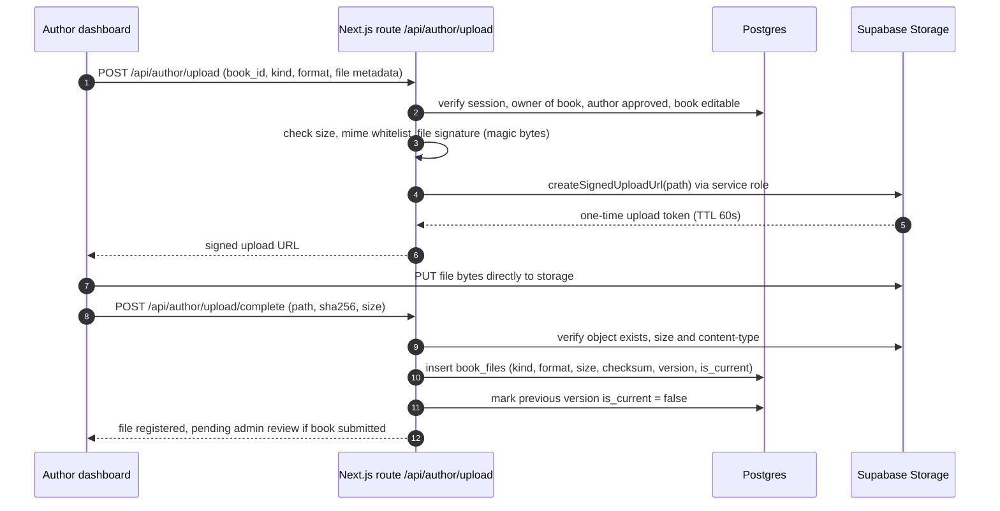
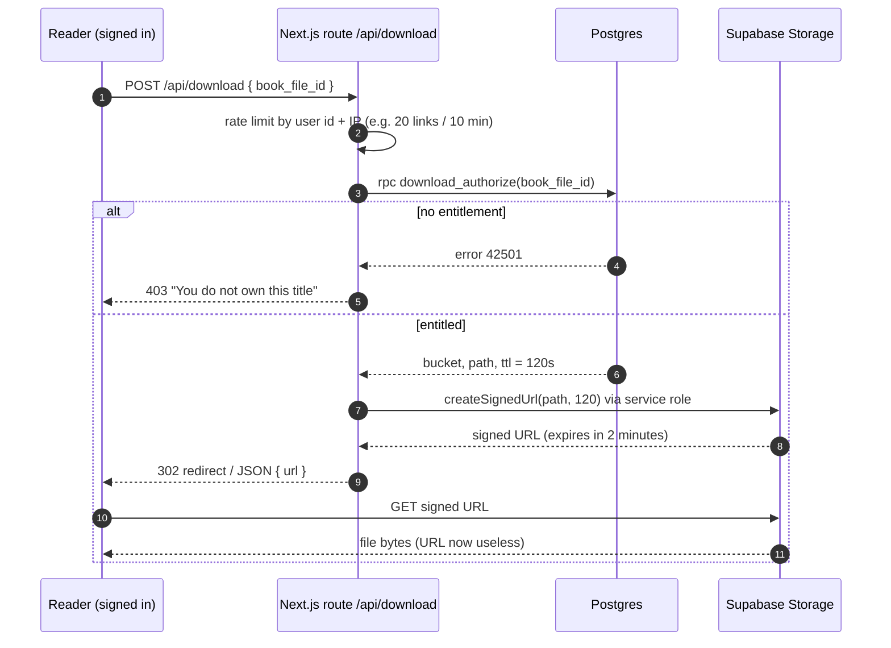

# 04 — Storage architecture

Requirement: **book files must never be publicly accessible.** This document is how
that is guaranteed, not merely intended.

---

## 1. Buckets

| Bucket | Public? | Contents | Size limit | Who can read |
| --- | :--: | --- | --- | --- |
| `book-files` | **No** | Paid digital editions — EPUB, PDF, MOBI, interior print PDFs | 200 MB | Only via server-signed download, after entitlement check |
| `book-samples` | **No** | Free preview PDFs / sample chapters | 20 MB | Only via server-signed download, after entitlement **or** book-is-published check |
| `submission-files` | **No** | Author application samples, manuscript submissions | 50 MB | Owner + admins (signed) |
| `book-covers` | Yes | Cover art thumbnails, author avatars | 10 MB | Public (no PII, no paid content) |
| `payout-docs` | **No** | Any KYC/payout documentation the provider requires | 10 MB | Owner + admins (signed, short TTL) |

Only `book-covers` is public, and it is deliberately a **different bucket** so a
mistake in one cannot leak paid content from another.

Every bucket is created with `file_size_limit` and an `allowed_mime_types` list, so
a misconfigured client cannot upload a 4 GB file or an executable:

```sql
-- Bucket definitions (applied via the Supabase CLI / dashboard, documented here)
-- book-files:      private, 209715200 bytes,
--                  allowed: application/epub+zip, application/pdf,
--                           application/x-mobipocket-ebook
-- book-samples:    private, 20971520 bytes,
--                  allowed: application/pdf, application/epub+zip
-- submission-files:private, 52428800 bytes,
--                  allowed: application/pdf, application/epub+zip, application/msword,
--                           application/vnd.openxmlformats-officedocument.wordprocessingml.document
-- book-covers:     public,  10485760 bytes,
--                  allowed: image/jpeg, image/png, image/webp
```

---

## 2. Object path convention

Paths are deterministic, collision-free and carry no secrets:

```
book-files/{book_id}/{file_kind}/v{version}/{uuid}.{ext}
book-samples/{book_id}/sample/v{version}/{uuid}.pdf
submission-files/{user_id}/{application_id}/{uuid}.{ext}
book-covers/{book_id}/cover/v{version}/{uuid}.webp
book-covers/{author_id}/avatar/v{version}/{uuid}.webp
payout-docs/{author_id}/{uuid}.{ext}
```

Rules:

- **Never** put an email, phone number, pen name or user id of a reader in a path.
- A random `uuid` filename prevents enumeration even if a path pattern leaks.
- `{version}` matches `book_files.version`; uploading a new edition creates v2 and
  leaves v1 intact for existing entitlements.
- Paths are stored in `book_files.storage_path` and are **never** sent to a client
  except inside a short-lived signed URL.

---

## 3. Upload flow

An author cannot upload directly into the private bucket with their session token.



Hardening applied at upload:

| Control | Reason |
| --- | --- |
| MIME whitelist **and** magic-byte sniffing | A `.pdf` extension is not proof of a PDF |
| Size limit enforced per bucket | Prevents storage-exhaustion abuse |
| SHA-256 recorded at registration | Dedupe, integrity check, tamper detection, and duplicate-content detection |
| Author must own the book and be `approved` | No cross-account writes |
| Book must be editable (`draft` / `changes_requested` / `approved`) | Files cannot be swapped on a book mid-sale; a new version is required |
| Optional malware scan hook (ClamAV or a provider) before `is_current = true` | A PDF is an executable-capable container |
| Server-side PDF normalisation (strip JavaScript, embedded files) | Removes the most common attack surface in ebook distribution |

---

## 4. Download flow — time-limited signed URLs

The only way bytes leave the private bucket is a signed URL minted by a server that
has just checked the caller's entitlement.



Design decisions:

| Decision | Value | Why |
| --- | --- | --- |
| Signed URL TTL | **120 seconds**, single use in practice | Long enough for a download to start, short enough that a leaked link is worthless |
| Issued by | Edge Function / route handler with the service role | The client cannot sign its own URLs |
| Entitlement check | `download_authorize()` in the database | One source of truth, re-used by every surface |
| Logging | `download_events` row per issuance | Dispute resolution, abuse detection |
| Rate limiting | Per user and per IP, sliding window | Prevents bulk harvesting of links |
| Concurrent downloads | 3 per user per file, 20 per hour | Prevents link farming while allowing normal re-downloads |
| Response headers | `Content-Disposition: attachment`, `Cache-Control: private, no-store` | No browser/CDN caching of paid content |
| Revocation | `entitlements.revoked_at` (refund/chargeback) | New links immediately fail; existing links die in ≤2 min |
| Watermarking | Per-purchase footer with order number (PDF stamping) — planned | Deters casual redistribution and traces leaks |

---

## 5. Storage RLS and API exposure

Storage policies are effectively **closed** for the file buckets:

```sql
-- No policies are created on storage.objects for these buckets at all.
-- Without a policy, authenticated and anon roles get nothing. Only the
-- service role (which bypasses RLS) can read or sign.
--
-- The only reading role is the server, via signed URLs.

-- For book-covers (public bucket), reads are granted and writes restricted:
create policy book_covers_public_read on storage.objects
  for select to anon, authenticated
  using (bucket_id = 'book-covers');

create policy book_covers_author_write on storage.objects
  for insert to authenticated
  with check (
    bucket_id = 'book-covers'
    and (storage.foldername(name))[1] = public.current_author_id()::text
  );
```

Additional measures:

- The storage endpoint is never proxied to the browser with the service role.
- `supabase-js` in the browser is initialised with the **anon** key only.
- Signed URLs are generated with `createSignedUrl`, never `getPublicUrl`, for the
  private buckets (a lint rule and a code review checklist item).
- Bucket listing is disabled for clients; object metadata is only exposed through
  `book_files`, which has no public read policy.
- Supabase Storage's own access logs plus `download_events` give two independent
  audit trails.

---

## 6. Integrity, versioning and retention

| Concern | Approach |
| --- | --- |
| Integrity | `checksum_sha256` stored at registration; verify on serve for large files if the platform allows |
| Versioning | `book_files.version` increments; one `is_current` per `(book, kind, format)` via partial unique index |
| Existing purchases | Entitlements point at the **book**, so a reader always receives the current file version — new editions are delivered automatically |
| Deletion | Objects are never hard-deleted while referenced by an order; use `is_current = false` and a retention window |
| Orphan cleanup | Nightly job lists bucket objects with no `book_files` row older than 24 h and removes them |
| Backups | Supabase automated backups for the database; storage backups via `storage.objects` manifest + periodic export |
| GDPR-style erasure | Account deletion removes PII and `book-covers` avatars; purchase and ledger records are retained in pseudonymised form |

---

## 7. Content moderation of files

Files are content too, and an upload is a moderation event:

1. Automated checks at upload: MIME/magic bytes, size, PDF JavaScript stripping,
   optional antivirus.
2. Admin preview of the actual file before `approved → published`.
3. Cover images reviewed for rights and decency at the same time.
4. Any file replaced after publication returns the book to `submitted` for review
   (planned rule: `book_files` insert while `books.status = 'published'` sets
   `status = 'submitted'` via trigger, keeping the book visible but flagging it).

---

## 8. What is intentionally absent

- No public bucket contains a paid file — ever.
- No long-lived signed URLs (nothing over 5 minutes).
- No storage path or bucket name exposed in the public catalogue payload.
- No reader email or name in any storage path.
- No service-role key in any client bundle.
