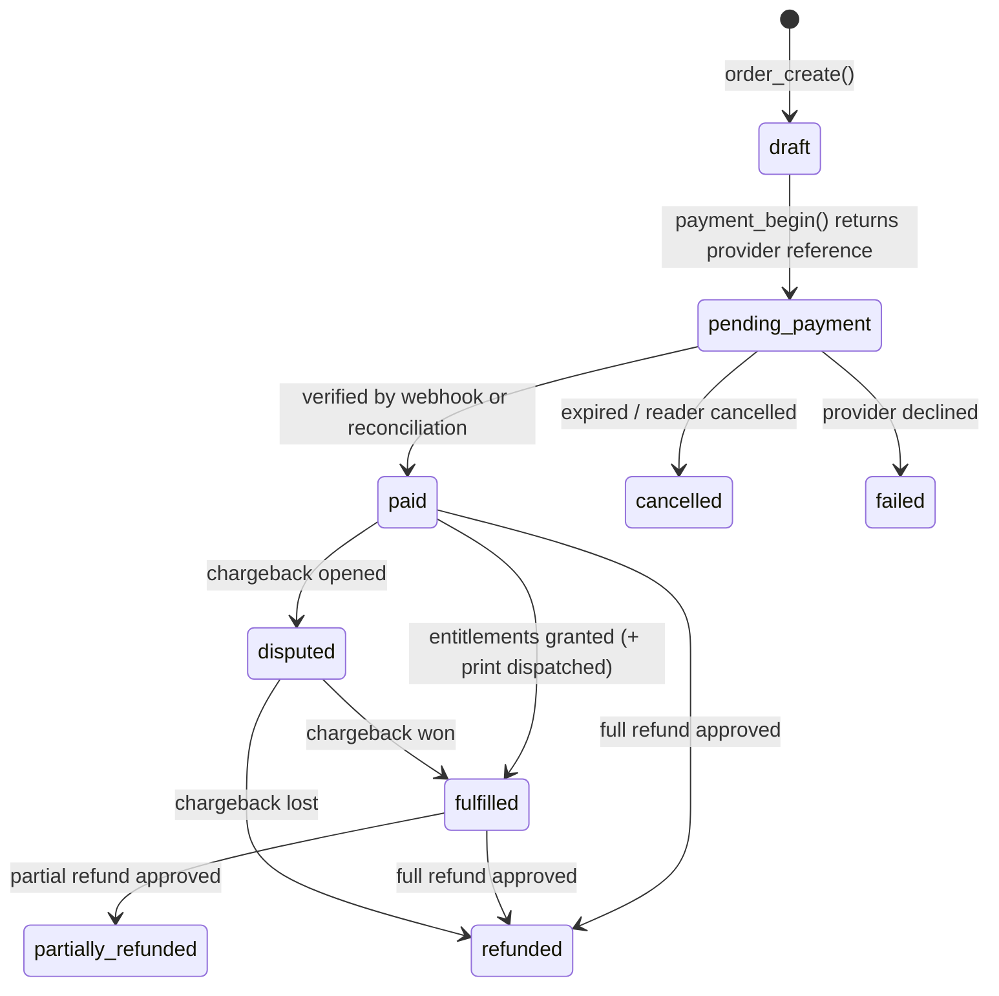
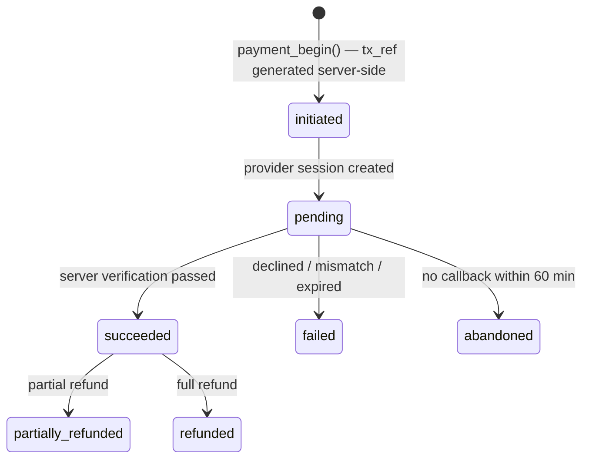
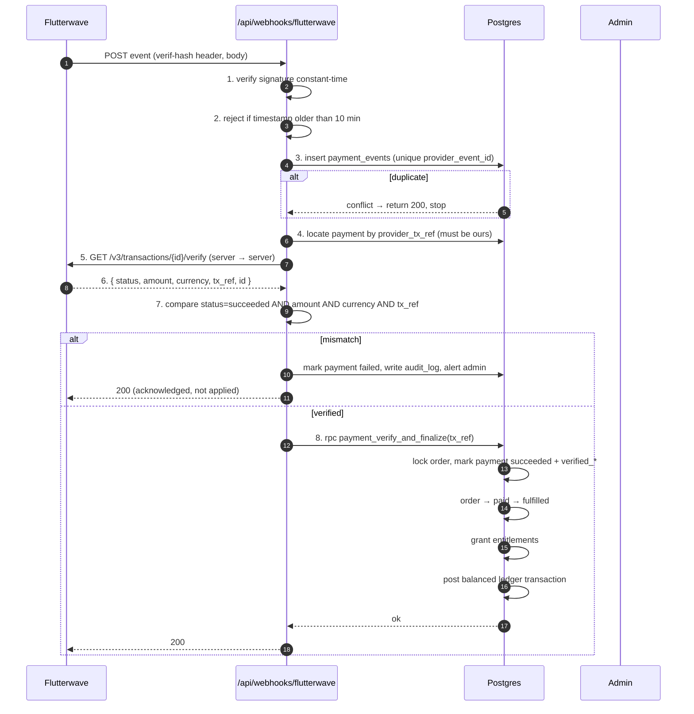
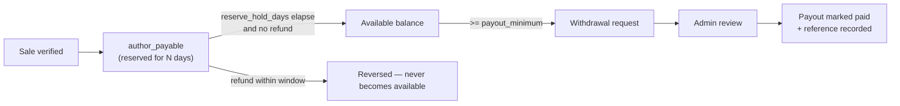
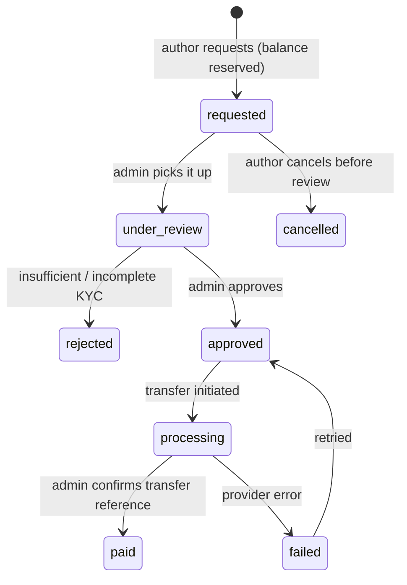

# 05 — Payments, commissions & earnings

Business rules being implemented:

- 90% to the author, 10% to the platform (INKFREEDOMPUBLISHING, a Business Name
  operated by PEACE-TECH MULTIBIZ COMMUNICATIONS).
- **No payment may be marked successful because of a browser redirect.** Success is
  a server-side fact.
- Earnings must be auditable: every naira traceable from a sale to a withdrawal.
- Payments will eventually run through Flutterwave. **Nothing is live now.**

---

## 1. Principles

| # | Principle | Consequence in the design |
| --- | --- | --- |
| P1 | The server decides what an order costs | `order_create()` reads prices from `book_prices`; the client never sends an amount |
| P2 | The server decides whether it is paid | Only `payment_verify_and_finalize()` sets `succeeded`, and only after a provider lookup |
| P3 | Money is integers | `bigint` minor units + ISO-4217 code; no floats anywhere |
| P4 | History is immutable | Prices, titles and commission rates are snapshotted onto `order_items` |
| P5 | Every movement is double-entry | Debits equal credits in each `ledger_transactions` row |
| P6 | Operations are idempotent | Provider events deduped; ledger transactions carry an `idempotency_key` |
| P7 | Nothing is deleted | Refunds and chargebacks post reversing entries |
| P8 | Balances are derived | `author_balances` is a view over the ledger, never a writable column |
| P9 | Currency is explicit | A price, order and ledger row all carry a currency code |

---

## 2. Order lifecycle



Rules:

- `paid` requires `paid_at` (check constraint).
- `fulfilled` requires entitlements to exist for every digital line.
- An order can hold **multiple payment attempts** (a reader retries after a failed
  card). Only one may be `succeeded`; a partial unique index enforces that:

```sql
create unique index payments_one_success_per_order
  on public.payments (order_id)
  where status = 'succeeded';
```

---

## 3. Payment lifecycle



The verification stamp is what makes a payment real:

```
payments.verified_at            not null
payments.verification_source    webhook | server_lookup | reconciliation | manual_admin
payments.verified_amount_minor  equals the order total, in the order currency
payments.verified_currency      equals the order currency
```

---

## 4. Server-side verification (the anti-fraud core)

### 4.1 What the browser is allowed to do

Nothing that affects money. The callback page exists to show "verifying…" and then
to poll `/api/checkout/status`. If the reader closes the tab, the order still
finalises from the webhook or the reconciliation job.

### 4.2 Verification steps (both paths share them)



### 4.3 Controls checklist

| Control | Implementation |
| --- | --- |
| Signature verification | Provider secret header, constant-time compare, secret in server env only |
| Replay protection | `payment_events` unique on `(provider, provider_event_id)`; event age check |
| Reference binding | `payments.provider_tx_ref` is generated server-side (UUID + prefix) and must match exactly |
| Amount/currency match | Compared to `orders.total_minor` / `orders.currency`; mismatch never pays out |
| Do-not-trust-the-redirect | Redirect handler never writes payment state; it only reads |
| Idempotency | `ledger_transactions.idempotency_key = 'sale:' || payment_id`; replays are no-ops |
| Concurrency | `SELECT ... FOR UPDATE` on the order row inside the finalisation function |
| Failure visibility | Every failed/mismatched attempt writes `audit_log` and increments `payments.reconciliation_attempts` |
| Reconciliation | Cron (5 min): re-verify `initiated`/`pending` payments older than 10 minutes, expire after 60 minutes |
| Refund windows | Verified payments can be refunded; refunds post reversing ledger entries |

### 4.4 Flutterwave integration plan (not yet enabled)

| Item | Plan |
| --- | --- |
| Mode | Sandbox first, with test keys in a non-production environment |
| Secret key storage | Vercel environment variable, server-only (`FLW_SECRET_KEY`), never `NEXT_PUBLIC_` |
| Checkout | Provider-hosted payment page (Standard) — card + bank transfer + USSD. We never see card data |
| Reference | `IFP-{order_number}-{short_uuid}`; stored on `payments.provider_tx_ref` |
| Verification API | `GET /v3/transactions/:id/verify` server-to-server; response archived in `payments.raw_response` |
| Webhook | `POST /api/webhooks/flutterwave`, secret hash validated, body stored raw before processing |
| Payouts | Initially **manual**: admin marks a withdrawal `paid` after a bank transfer, with the transfer reference recorded. Automated transfers only after a separate approval |
| Keys in repo | None. `.env.example` lists variable **names** only, with empty values |
| Go-live gate | Written approval from you + sandbox test matrix passed + reconciliation job running |

> The current build ships **no** provider credentials and **no** live calls. A mock
> provider adapter exercises the same code path in development so verification,
> finalisation and the ledger can be tested end to end without a payment account.

---

## 5. Commission model

### 5.1 The rule

```
platform_fee = round(line_total × platform_fee_bps / 10000)   -- round half up
author_share = line_total − platform_fee
```

`platform_fee_bps` defaults to **1000** (10.00%), giving **9000** (90.00%) to the
author. The commission base is the **book subtotal only** — shipping and tax are
excluded, because the author is not selling postage and the platform is merely
collecting tax.

### 5.2 Snapshot, not lookup

`order_items.commission_bps` is written at sale time. If the platform later changes
the rate to 12%, existing orders, refunds and reports keep the 10% they were sold
under. Historical accuracy beats convenience.

### 5.3 Rounding

The fee is rounded half-up and the author receives **the remainder**, so:

```
author_share + platform_fee == line_total      (exact, always)
```

No rounding creates or destroys money. Multi-line orders compute per line, so an
author is never short-changed by the aggregation order.

### 5.4 Worked example — single item

| Step | Amount |
| --- | --- |
| Paperback, ₦10,000.00 | `1_000_000` minor |
| Platform fee 10% | `100_000` |
| Author share 90% | `900_000` |
| Ledger | `payment_clearing` DR 1,000,000 · `author_payable` CR 900,000 · `platform_revenue` CR 100,000 |

### 5.5 Worked example — mixed basket, two authors

Basket: Author A paperback ₦10,000 (`1_000_000`) + Author B ebook ₦4,999 (`499_900`),
shipping ₦1,500 (`150_000`). Order total `1_649_900`.

| Line | Total | Fee (10%) | Author net |
| --- | ---: | ---: | ---: |
| A paperback | 1,000,000 | 100,000 | 900,000 |
| B ebook | 499,900 | 49,990 | 449,910 |
| Shipping (no commission) | 150,000 | 0 | — (platform bears cost) |

Ledger for the sale transaction:

| Account | Direction | Amount |
| --- | --- | --- |
| `payment_clearing` | debit | 1,649,900 |
| `author_payable` (A) | credit | 900,000 |
| `author_payable` (B) | credit | 449,910 |
| `platform_revenue` | credit | 149,990 |
| `platform_revenue` (shipping) | credit | 150,000 |

Debits `1,649,900` = credits `899,990 + 100,000 + 150,000 + 499,910`
— the constraint trigger refuses the transaction otherwise.

---

## 6. The ledger

### 6.1 Accounts

| Account | Type | Meaning |
| --- | --- | --- |
| `payment_clearing` | Asset | Money the provider owes us but has not yet settled |
| `author_payable` | Liability | The author's 90% — money we hold for them |
| `platform_revenue` | Income | Our 10% |
| `tax_payable` | Liability | Tax collected, owed to the authority |
| `author_reserve` | Liability | Held back during the refund window (see §7) |
| `payout_clearing` | Asset/clearing | In transit to the author's bank |
| `adjustments` | Balancing | Manual corrections, always with a written reason |

### 6.2 Posting rules

| Event | Debit | Credit |
| --- | --- | --- |
| **Sale** (verified) | `payment_clearing` (order total) | `author_payable` (per author, net) · `platform_revenue` (fees + shipping) · `tax_payable` (tax) |
| **Full refund** | `author_payable` (net) · `platform_revenue` (fee) | `payment_clearing` (total) |
| **Partial refund of one line** | `author_payable` (line net) · `platform_revenue` (line fee) | `payment_clearing` (line total) |
| **Chargeback** | same as refund, plus a `chargeback` memo and admin flag | |
| **Reserve hold** (optional) | `author_payable` | `author_reserve` |
| **Reserve release** | `author_reserve` | `author_payable` |
| **Withdrawal approved** | `author_payable` | `payout_clearing` |
| **Payout confirmed by bank** | `payout_clearing` | `payment_clearing` |
| **Correction** | `adjustments` (or the affected account) | counterpart, with `memo` and `created_by` |

Every transaction stores `commission_bps` (where applicable), the currency, the
base-currency equivalent and a human-readable `memo`, e.g.
`"Sale of The Weight of Water (paperback) — order IFP-2026-000137"`.

### 6.3 Guarantees

- `ledger_entries` has **no** `UPDATE`/`DELETE` grant and an append-only trigger.
- A deferred constraint trigger validates `sum(debits) = sum(credits)` per
  transaction at commit.
- `ledger_transactions.idempotency_key` is unique, so a replayed webhook cannot
  double-credit an author.
- Author balances are computed from entries; there is no `balance` column to corrupt.
- The platform's own revenue is in the same ledger, so author statements and
  platform accounts are always reconcilable.

### 6.4 Author statement

An author's earnings page reads:

| Figure | Source |
| --- | --- |
| Gross sales | Σ `order_items.line_total_minor` for own items, paid orders |
| Platform fees | Σ `round(line_total × commission_bps / 10000)` |
| Refunds | Σ reversing entries for own lines |
| **Net earnings** | Σ `author_payable` credits − debits |
| Withdrawn | Σ `payout_clearing` credits attributable to own withdrawals |
| **Available balance** | `author_balances.available_minor` |
| Pending (in reserve) | `author_balances.reserved_minor` |

Every figure is filterable by date range and currency, and every figure can be
drilled into ledger rows.

---

## 7. Reserve window & payout eligibility



Defaults (configurable in `platform_settings`): `reserve_hold_days = 7`,
`refund_window_days = 14`, `payout_minimum_minor = 500_000` (₦5,000).

Balance arithmetic on request (inside a `SERIALIZABLE` transaction with a row lock):

```
available = ledger_payable − ledger_reserved − withdrawals_in_flight
request only if available >= amount and amount >= payout_minimum
```

If a later chargeback pushes the balance negative, the author's account shows a
negative balance and future sales offset it; withdrawals are blocked. Nothing is
deleted or written off silently.

---

## 8. Withdrawals



- **Manual payouts at launch.** The admin records a bank transfer reference and
  marks the withdrawal `paid`; the ledger posts the payout. Automated provider
  transfers require a separate, explicit approval.
- The payout account is a provider token + `last4`; no account numbers are stored.
- Withdrawal amounts are reserved (a ledger hold) when requested, so an author
  cannot request the same balance twice.
- Every state change writes `withdrawal_events` + `audit_log`.

---

## 9. Multi-currency

Requirement 9: support multiple currencies *subject to payment provider
availability*.

| Rule | Implementation |
| --- | --- |
| Availability is data | `currencies.is_enabled` **and** `currencies.provider_supported` must both be true to appear at checkout |
| Prices are explicit | `book_prices` holds a row per enabled currency. No silent FX conversion at checkout — the reader pays the exact amount set by the author |
| Order currency is fixed | An order's currency is chosen at `order_create()` and cannot change; `order_items.currency` must equal `orders.currency` (trigger) |
| Ledger is per-currency | `ledger_entries.currency` on every row; balances are per author **per currency**. No cross-currency netting |
| Reporting in one base | `orders.base_currency` + `fx_rate_to_base` snapshot, and `ledger_entries.base_amount_minor`, so consolidated reporting is stable and historical |
| FX rates are stored | `fx_rates` with `effective_at`; the rate used is snapshotted, never recomputed later |
| Settlement | `currencies.settlement_currency` records what the provider actually settles in; a GBP sale settling in NGN is visible in the data, not hidden |
| Minimum/maximum | `currencies.min_amount_minor` / `max_amount_minor` guard provider limits |
| Payout currency | `author_profiles.payout_currency` must be enabled and provider-supported; a withdrawal is only possible in a currency the author holds a balance in |
| Rounding | Per-currency `minor_unit` (0 for JPY-style currencies, 2 for NGN/USD); formatting uses `Intl.NumberFormat` |

Launch position: **NGN enabled; other currencies present in the table but disabled**
until you confirm which ones your Flutterwave account can actually collect and
settle. Enabling a currency is an admin action with an audit entry, not a code change.

---

## 10. Reconciliation & operations

| Job | Cadence | Purpose |
| --- | --- | --- |
| Pending payment sweep | every 5 min | Re-verify `initiated`/`pending` payments older than 10 min; expire after 60 min |
| Provider settlement import | daily | Match provider settlements to `payment_clearing`; flag gaps |
| Ledger invariant check | hourly | Assert every transaction balances; alert on any imbalance |
| Orphaned-order check | daily | Paid orders without entitlements; entitlements without a paid order |
| Balance sanity check | daily | `author_balances` vs Σ ledger, per author and currency |
| Webhook failure review | daily | `payment_events` stuck in `failed` |

Any anomaly raises an `audit_log` entry and a notification to the admin dashboard.

---

## 11. Failure modes & edge cases

| Scenario | Handling |
| --- | --- |
| Webhook arrives before the order commit | Payment row already exists (created before redirect); the event is stored and retried until the order is visible |
| Webhook arrives twice | Deduped by `provider_event_id`; finalisation is idempotent |
| Webhook never arrives | Reconciliation job verifies by reference and finalises |
| Reader closes the tab after paying | Same as above — the browser is never part of the truth |
| Reader pays the wrong amount | Verification mismatch → payment `failed`, order stays `pending_payment`, admin alerted, no ledger entry |
| Reader pays twice (two successful attempts) | Partial unique index prevents a second `succeeded`; the excess is refunded manually and logged |
| Card declined, reader retries | New `payments` row, same order, same reference family |
| Refund after payout | Negative author balance; future earnings offset; blocked withdrawals; admin notified |
| Chargeback after payout | Reversing ledger entry + dispute record; author statement shows it explicitly |
| Currency disabled mid-order | Existing orders complete in their currency; new orders cannot select it |
| Commission rate changed | New rate applies to new order items only; snapshots protect history |
| Service-role outage | Verification retries from the queue; no partial state because finalisation is one transaction |

---

## 12. Reconciliation of trust — summary

| Question | Answer |
| --- | --- |
| Can a browser mark an order paid? | No — no code path and a database `CHECK` forbids it |
| Can an author edit their earnings? | No — the ledger is append-only and has no client write grant |
| Can an author see another's earnings? | No — RLS scopes `ledger_entries` and `order_items` to `current_author_id()` |
| Can a price be tampered with? | No — prices are read server-side inside the order transaction and snapshotted |
| Can the platform's cut be changed retroactively? | No — `commission_bps` is snapshotted on each order item |
| Can a replayed webhook double-pay? | No — unique `provider_event_id` and unique `idempotency_key` |
| Is every kobo traceable? | Yes — double-entry ledger, refunds as reversing entries, withdrawals linked to transactions |
