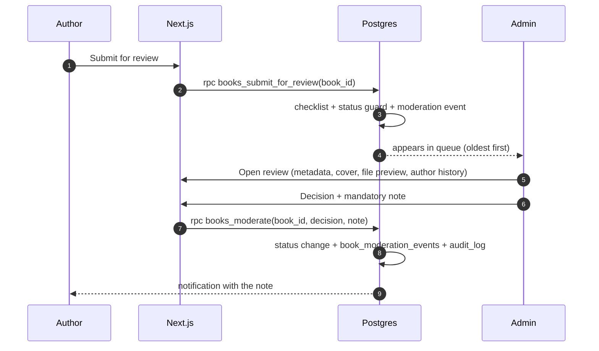

# 06 — Book approval workflow & administrator dashboard

---

## 1. Moderation workflow

### 1.1 States and who moves them

| From | To | Actor | Notes |
| --- | --- | --- | --- |
| — | `draft` | Author | Created by the author; invisible to everyone else |
| `draft` | `submitted` | Author | Requires: title, hook, description, category, ≥1 format, ≥1 price, a file for each digital format, cover image |
| `submitted` | `changes_requested` | Admin | Note is mandatory; the author sees it on the book |
| `submitted` | `rejected` | Admin | Note is mandatory; the author may rework and resubmit as a new submission |
| `submitted` | `approved` | Admin | Clears the book for publication |
| `changes_requested` | `submitted` | Author | Resubmission after edits |
| `changes_requested` | `draft` | Author | Withdraws the submission |
| `approved` | `published` | Admin | Book appears in the public catalogue |
| `published` | `unpublished` | Admin | Withheld; existing buyers keep their entitlements |
| `unpublished` | `published` | Admin | Reinstated |
| `published` | `archived` | Admin | Retired; order history and entitlements preserved |
| `draft` | `archived` | Author | Author retires an unpublished book |
| `rejected` | `draft` | Author | Rework |

Enforced by the `books_status_guard` trigger — the UI is a convenience, the
database is the rule. Any transition that is not in this table raises an exception.

### 1.2 Submission checklist (pre-flight, server-side)

`books_submit_for_review()` refuses to submit unless:

1. Author is `approved` and `active`.
2. Book belongs to the caller.
3. Title, hook (≤400 chars), at least one description paragraph, and a category.
4. At least one format with `is_available = true`.
5. Every available format has an active price in the platform's base currency.
6. Every `ebook` / `pdf` format has a `book_files` row with `is_current = true`
   and a passing scan.
7. A cover image exists.
8. Rights declaration checkbox was accepted (recorded with a timestamp in
   `book_moderation_events.note`).

The response lists **every** failing item at once, so the author can fix them in one
pass rather than discovering them one at a time.

### 1.3 Review queue & decision



Admin actions available on an approved book: `publish`, `unpublish`, `archive`,
feature/unfeature, reorder featured rank, and inspect files and moderation history.

### 1.4 Rules that protect authors

- An admin decision **must** carry a note (database `CHECK` in the moderation
  function) — authors always learn why.
- The full history is retained: no decision is overwritten.
- A book's editorial note is visible to its author only, never to other authors.
- Rejections do not delete the book: the author keeps their work, cover and files.
- Publication never changes the author's royalty rate; the standard 90/10 applies
  (any per-book override would be a separate, audited decision).
- Unpublishing does not revoke a reader's entitlement.

### 1.5 Notifications

Email (once a provider is connected) plus in-app events:

| Event | Recipient |
| --- | --- |
| Book submitted | Admins |
| Changes requested / rejected / approved | Author (with note) |
| Book published | Author |
| Author application decided | Applicant |
| Withdrawal requested | Admins |
| Withdrawal approved / paid / rejected | Author |
| Payment mismatch or refund | Admins |

Until an email provider is connected, all of these are written to a
`notifications` table and shown in-app; nothing claims an email was sent.

---

## 2. Administrator dashboard plan

Route tree (proposed, not yet built):

```
/admin
  /admin                    Overview: today's numbers, queues, alerts
  /admin/moderation         Book review queue
  /admin/moderation/[id]    Single-book review workspace
  /admin/authors            Authors, applications, suspensions
  /admin/books              All books, all statuses
  /admin/orders             Orders, payments, refunds
  /admin/payments           Verification & reconciliation console
  /admin/withdrawals        Payout queue
  /admin/finance            Ledger explorer, platform revenue, tax
  /admin/settings           Commission, currencies, payout policy, legal entity
  /admin/audit              Immutable audit log search
```

### 2.1 Screen responsibilities

| Screen | Key elements | Guardrails |
| --- | --- | --- |
| **Overview** | Pending submissions, pending withdrawals, failed verifications, today's gross/net, open disputes | Read-only metrics; no inline money edits |
| **Moderation queue** | Filters by age/category/author, bulk "claim" to avoid two admins reviewing the same book | Decision requires a note; actions audited |
| **Book review** | Metadata, cover, file preview in a sandboxed viewer, author history, previous decisions | Files previewed through the same signed-URL service (admin entitlement path) |
| **Authors** | Application inbox, approve/reject, suspend with reason, payout accounts | Approving is the *only* way to create an author role; audited |
| **Orders** | Search by number/email/date, status timeline, linked payment attempts, items and ledger rows | Refunds are proposals until approved; nothing is deleted |
| **Payments** | Pending and mismatched payments, "re-verify now", raw provider payload | Manual override requires a reason and is tagged `manual_admin` in `verification_source` |
| **Withdrawals** | Queue with available balance, approve/reject/process, transfer reference entry | Cannot approve more than the available balance (server-enforced) |
| **Finance** | Revenue by period/currency, author payables, tax collected, ledger search, export CSV | Read-only; corrections go through a reasoned adjustment function |
| **Settings** | Commission bps, reserve days, payout minimum, currency enablement, legal entity fields | Changes audited with before/after; commission changes never retroactive |
| **Audit** | Filter by actor, action, entity, date; diff view of before/after | Append-only; no delete |

### 2.2 Admin technical controls

- Access requires `profiles.role = 'admin'` **and** MFA on the Supabase account.
- The admin area is separately guarded in middleware *and* by RLS.
- Admin mutations go through `SECURITY DEFINER` functions that write `audit_log`
  in the same transaction — an audited action cannot partially succeed.
- Destructive operations (delete author, purge files) are disabled in v1; archive
  is used instead.
- Elevated sessions are short-lived; re-authentication is required for settings
  changes and payout approvals.
- Every admin action records `request_id`, `actor_id`, IP hash and before/after state.

### 2.3 Figures the dashboard must never invent

No placeholder KPIs, no fabricated "sales up 32%". Empty states are shown when
there is no data, with the reason ("no orders yet — payments not enabled").
This matches the honesty rule already applied to the Phase 1 UI.

---

## 3. Author dashboard plan

```
/author
  /author/books            Own catalogue, statuses, submission checklist
  /author/books/new        Create a book
  /author/books/[id]       Edit, files, prices, formats, submit for review
  /author/sales            Sales by title, period, currency
  /author/earnings         Ledger-backed statement, downloadable CSV
  /author/withdrawals      Request and track payouts
  /author/payouts          Payout account (provider token)
  /author/profile          Pen name, bio, avatar, slug
```

Author-facing guarantees:

- Only their own books, sales lines and ledger entries are visible (enforced by RLS,
  not by the query alone).
- No reader PII is ever exposed — sales lines carry an order number, not an identity.
- Earnings always reconcile to the ledger; the statement can be exported.
- A book cannot be edited into a different author, and files cannot be replaced on a
  published title without returning it to review.
